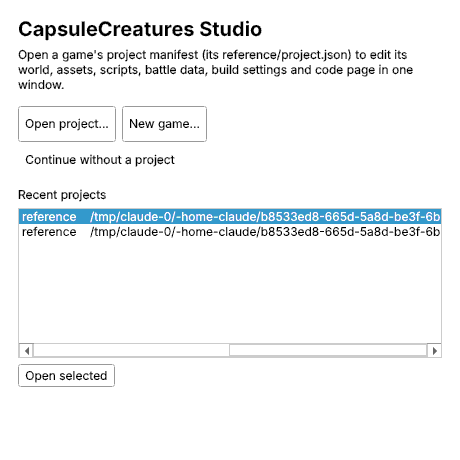
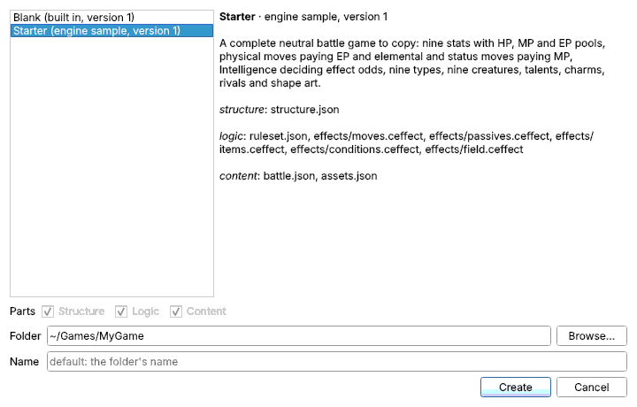
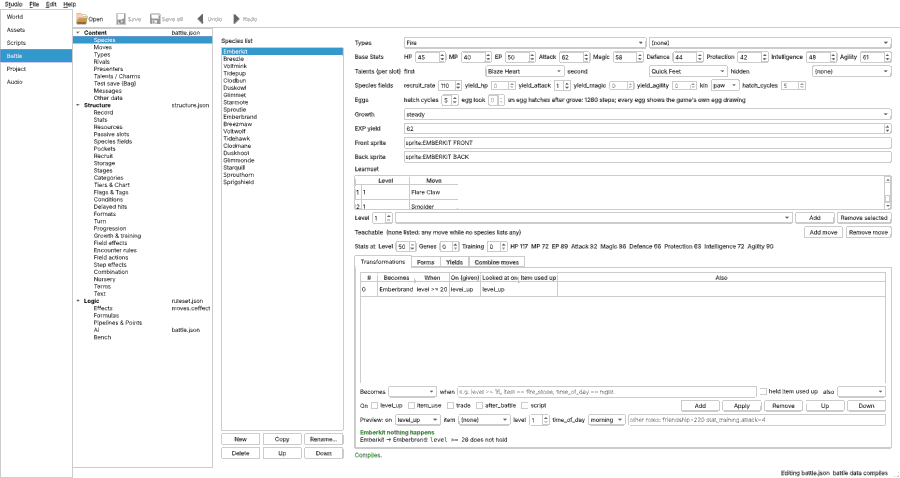
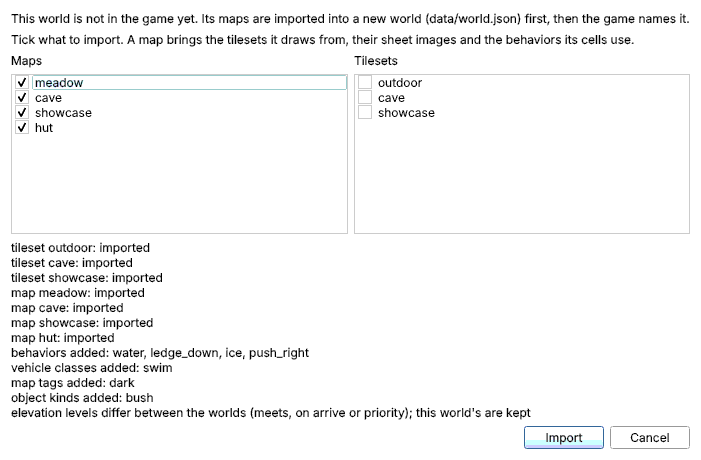
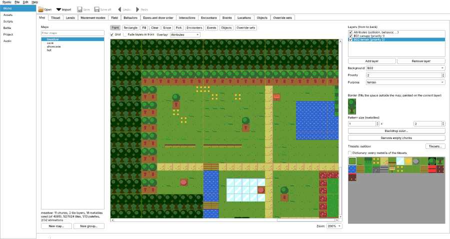
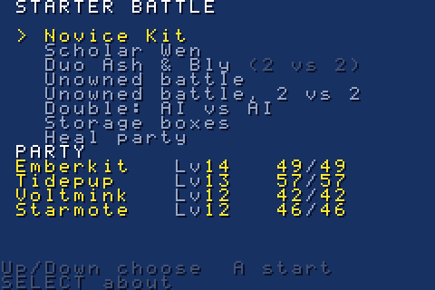
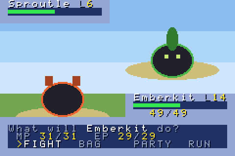
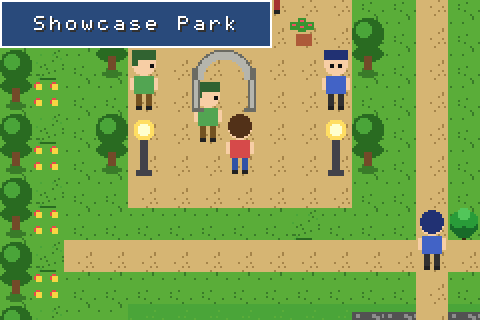
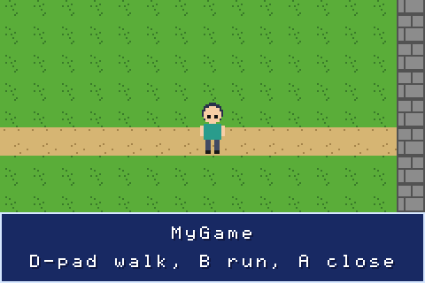

# Getting started

This guide takes you from nothing to a CapsuleCreatures game running on a
Game Boy Advance emulator, a GBA flash cartridge and your desktop. There are
two ways in:

| Route | You get | You need |
|---|---|---|
| [A. Prebuilt downloads](#route-a-the-prebuilt-downloads) | the Studio (every editor) and the two sample programs, ready to run | nothing to install |
| [B. Full install](#route-b-the-full-install) | everything in A, plus building your own changes for GBA and desktop | the source, and the tools that `./setup` installs |

Start with A to look around. Move on to B when you want to build.

## Route A: the prebuilt downloads

### A1. Download

Open the project's
[Releases page](https://github.com/TheWildDeadHero/CapsuleCreatures/releases)
and download the files for your system. `<version>` is the release's
version, for example `2026.10.31.0900`.

| System | The Studio | The samples |
|---|---|---|
| Linux (x86_64) | `capsule-studio-<version>-linux-x86_64.tar.gz` | `capsule-samples-<version>-linux-x86_64.tar.gz` |
| Windows (64-bit) | `capsule-studio-<version>-windows-x64.zip` | `capsule-samples-<version>-windows-x64.zip` |
| macOS (Apple silicon and Intel) | `capsule-studio-<version>-macos-universal2.zip` | `capsule-samples-<version>-macos-universal.zip` |
| Game Boy Advance | | `capsule-samples-<version>-gba.zip` (the two `.gba` ROMs) |

`SHA256SUMS` on the same page lists a checksum for every file.

Unpack each download into a folder of its own: double-click it, or
right-click it and choose **Extract All...** (Windows) or **Extract Here**
(Linux). Keep the files in each folder together.

### A2. Open the Studio

The Studio is one window that holds every editor. The downloads are not
code-signed, so your system warns you the first time you open them.

| System | How to open it |
|---|---|
| Linux | Double-click `studio` in the unpacked folder. To add it to your application menu, run `add-to-menu.sh` once. If the file manager opens it as text, right-click it, choose **Properties > Permissions** and tick **Allow executing file as program** |
| Windows | Double-click `studio.exe`. If SmartScreen says "Windows protected your PC", click **More info**, then **Run anyway** (asked once) |
| macOS | Double-click `CapsuleStudio.app` and close the warning. Then open **System Settings > Privacy & Security**, scroll to the message about CapsuleStudio and click **Open Anyway** (once). On older systems, right-click the app and choose **Open** |

Linux needs glibc 2.34 or newer for the Studio (Ubuntu 22.04, Debian 12,
Fedora 35, RHEL, AlmaLinux or Rocky Linux 9, or a current Arch-based
system); the samples need glibc 2.28 or newer. On an X11 desktop, Qt also needs
the system's `xcb-util-cursor` library: `xcb-util-cursor` on Arch and Fedora,
`libxcb-cursor0` on Debian and Ubuntu. Wayland desktops need nothing extra.

The Studio opens on its start window:



### A3. Make a game from the Starter template

The **Starter** template is a complete small battle game to copy: nine
creatures, their moves, three rivals, the rules and simple-shape art.

1. On the start window, click **New game...** (or **Studio > New game...**
   later).
2. Pick **Starter (engine sample, version 1)** in the list. The right side shows what
   it holds.
3. Next to **Folder**, click **Browse...** and choose a new, empty folder,
   for example `Games/MyGame` in your home folder. **Name** is optional; the
   folder's name is used when it is empty.
4. Click **Create**.



The Studio opens the new game on its **World** page, with its first map.
Its data is in `MyGame/data/`, its first scene in `MyGame/src/game.cpp`, and
`MyGame/reference/project.json` names them. The game runs as it is: the
player stands on the first map and walks with the D-pad, and a text box
names the game. [B7](#b7-build-and-run-your-own-game) builds and runs it. The page list on the left goes to each part of the game: click
**Battle** to see the creatures, moves and rules, and **Assets** for their
sprites and texts.



### A4. Edit a map

Every new game starts with a small world of simple shapes, so it builds from
the start: `MyGame/data/world.json` with one tileset, **basic** (ground,
path and wall), and one map, **start** (ground with a path across the
middle, a wall around the edge; the game starts in the middle of the path).
The player's sprite is **sprite:PLAYER** on the **Assets** page.

1. Click **World** in the page list (a new game opens there). The **Map**
   tab shows **start**.
2. Click a layer under **Layers** on the right, click a tile in the palette
   below it (**ground**, **path** or **wall**), and click or drag on the map
   to paint. Right-click picks the tile under the mouse; **Undo** and
   **Redo** are in the toolbar. The wall is blocked on the attribute layer
   (**collision**); paint the attribute layer to block or free other cells.
3. Click **Save all** (Ctrl+Shift+S).

Add your own tiles on the **Tileset** tab (**New tileset...**, or import a
sheet image) and more maps on the **Map** tab (**New map...**).

To bring in the map sandbox, the engine's sample world, which comes with the
Studio:

1. Choose **Studio > Add world to game...** (also in the World page's
   **File** menu), and click **Map sandbox**.
2. The map sandbox is not in your game, so the Studio offers to import it
   into the game's world. Every map is ticked (untick the ones you do not
   want), and the list below them says what comes along. Click **Import**.

   The Studio adds those maps and their tilesets, images and terrain to
   `MyGame/data/world.json`, points their encounters at your game's
   `data/battle.json` and opens the world on the **World** page. A window
   lists what was imported; signs, people and warps that need the map
   sandbox's scripts are left out, and the list says so.
3. Open the **Map** tab, pick **meadow** in the map list and paint on it as
   above.

To use another world, click **World file...** in step 1 and pick its
`world.json`. A world inside the game folder is named as it is; one from
elsewhere is imported first, as above. A game made with an older toolkit
may have no world: its **World** page says **This game has no world yet**,
with **Create a new world** (an empty world: add a tileset and a map before
it builds) and **Add an existing world...**.





The [toolkit user guide](https://github.com/TheWildDeadHero/CapsuleCreatures_Toolkit/blob/main/docs/USER_GUIDE.md)
explains every page and editor.

### A5. Run the samples

The samples download holds two programs made with the engine:

- **Starter Battle** (`capsule_starter_battle`): the Starter game's battles.
  Fight three rivals or unowned creatures, recruit creatures, heal, look into
  the storage boxes, or watch the AI play both sides. SELECT on the first
  menu shows the About page.
- **Map Sandbox** (`capsule_sandbox_map`): the overworld. Walk the park, the
  meadow and the cave, talk to people, read signs and take the warps. SELECT
  while walking shows a debug overlay (hidden at start); START opens a menu,
  and SELECT there shows the About page. It has no battles.

| Where | How to start a sample |
|---|---|
| Linux | double-click `capsule_starter_battle` or `capsule_sandbox_map` (needs glibc 2.28 or newer) |
| Windows | double-click `capsule_starter_battle.exe` or `capsule_sandbox_map.exe`; SmartScreen asks once, as for the Studio |
| macOS | open `Starter Battle.app` or `Map Sandbox.app`; macOS asks once, as for the Studio |
| GBA emulator | open mGBA (https://mgba.io), choose **File > Load ROM...** and pick `capsule_starter_battle.gba` or `capsule_sandbox_map.gba`; no BIOS file is needed |
| GBA hardware | see [B5. Put it on a flash cart](#b5-put-it-on-a-flash-cart) |





Desktop keys (the GBA's buttons):

| Key | GBA button | What it does |
|---|---|---|
| Arrow keys | D-pad | move the cursor / walk |
| X | A | choose, talk, read a sign |
| Z | B | back; hold while walking to run |
| Enter | START | Map Sandbox: the menu |
| Backspace | SELECT | Starter Battle: the About page (first menu); Map Sandbox: the debug overlay while walking, the About page in the START menu |
| Q / W | L / R | Starter Battle: previous / next storage box; Map Sandbox: collision view / noclip |

mGBA's own default keys are the same for the D-pad, A (X), B (Z), START
(Enter) and SELECT (Backspace); its L and R are A and S.

The `README.txt` in each samples download has the same notes for its
platform. To change a sample and build it yourself, open it in the Studio
as a project of your own ([A6](#a6-open-a-sample-as-a-project)).

### A6. Open a sample as a project

Both samples are also in the Studio as **sample projects**: a copy of one
becomes a game of your own, which you can open, change and (with route B)
build like any game.

1. In the Studio's start window, click **Open a sample...** (beside
   **New game...**). With a game already open, choose **Studio > Open a
   sample...**.
2. Pick **Starter Battle** or **Map Sandbox**; each row says in one line what
   the sample shows.
3. Click **Browse...** and choose a new, empty folder for the copy, for
   example `Games/MyWorld` in your home folder. A **Name** is optional (the
   folder's name is used); click **Copy and open**.

The Studio copies the sample into that folder and opens it: the Map
Sandbox on its **World** page with its maps, the Starter Battle on its
**Battle** page. The copy has the sample's code (`src/`), its data (`data/`),
its own copy of the Starter battle data (`data/starter/`) and a `README.md`
with the controls; nothing in it points back into the Studio's files, so
change anything you like and **Save all**. The Studio does not copy into a
folder that already has files, or into its own folder.

Building the copy needs the tools of route B: see
[B7](#b7-build-and-run-your-own-game). On the command line the same copy is
`./capsule-studio sample copy sandbox_map ~/Games/MyWorld`
(`./capsule-studio sample list` names the samples).

## Route B: the full install

Route B builds the engine from source. It uses the same tools on every
system: CMake, a C++ compiler, devkitPro's devkitARM for the GBA and mGBA to
run the ROMs. One installer, `./setup`, puts them all in place.

### B1. Get the source

Clone the umbrella repository **with its submodules** (`engine/` and
`toolkit/`):

```
git clone --recurse-submodules https://github.com/TheWildDeadHero/CapsuleCreatures.git
```

If you cloned without them, run `git submodule update --init --recursive`
inside the clone. A Git GUI works as well, as long as it checks out the
submodules.

The commands below run in a terminal opened in the `CapsuleCreatures`
folder. Most file managers have **Open in Terminal** on a folder's
right-click menu; on Windows, see B2 for which terminal to use.

### B2. Install the tools

```
./setup --dry-run     # shows every step, changes nothing
./setup               # installs; asks before it changes anything
```

On Windows, run `setup.cmd -DryRun` and then `setup.cmd` from a Command
Prompt or PowerShell window in the folder.

What it installs:

- **GBA:** devkitPro's devkitARM, libgba and gbafix (devkitPro's `gba-dev`
  group), in `/opt/devkitpro`.
- **Desktop:** a C/C++ compiler, make, CMake, Python 3, git, SDL2's
  development files and mGBA.
- **The toolkit's Python environment:** `toolkit/.venv`, with the Studio's
  pinned packages. Nothing is installed system-wide for it.

How it works on each system:

| System | GBA tools from | Desktop tools from |
|---|---|---|
| Arch-based (Arch, CachyOS, EndeavourOS, Manjaro) | devkitPro's own pacman repositories, added to `/etc/pacman.conf` (backed up first) | the official repositories (`pacman -S --needed`) |
| Debian-based (Debian, Ubuntu, Mint, Pop!_OS) | devkitPro's official installer script | apt (on Ubuntu, enable `universe` for mGBA) |
| Fedora family | Fedora's `pacman` plus devkitPro's repositories | dnf |
| macOS | devkitPro's pacman package | Homebrew (install it first) |
| Windows 10/11 | devkitPro's graphical installer: tick **GBA Development** in its window | winget (Git, MSYS2, mGBA) and MSYS2's UCRT64 packages |

The installer never uses the AUR and never upgrades the rest of your system.
On Arch-based systems it syncs only devkitPro's package databases; if pacman
then cannot fetch a package, it stops and suggests `sudo pacman -Syu` for
you to run. It can be re-run safely, and it ends by checking each part,
including a test compile for the GBA. `--gba-only` and `--desktop-only`
(`-GbaOnly`, `-DesktopOnly` on Windows) install one half.
`toolkit/install/SUPPORT.md` has the details for each system.

On Windows, build from the **MSYS2 UCRT64** shell (in the Start menu after
setup): it has the compilers and CMake. `cd` to the clone there, for example
`cd /c/Users/you/CapsuleCreatures`.

### B3. Build the starter for GBA and desktop

```
./build gba-release        # GBA ROMs
./build desktop-release    # Linux and macOS programs
./build windows-release    # Windows programs (in the MSYS2 UCRT64 shell)
```

Each command configures and builds the engine with one CMake preset. The
build folder is `engine/build/<preset>/`. The first desktop build downloads
SDL2's pinned source once, so it needs a network connection. A build that
finished prints `GBA ROM (capsule_starter_battle.gba): ... of 8388608 B` for
each ROM.

| Preset | The Starter Battle | The Map Sandbox |
|---|---|---|
| `gba-release` | `engine/build/gba-release/capsule_starter_battle.gba` | `engine/build/gba-release/capsule_sandbox_map.gba` |
| `desktop-release` | `engine/build/desktop-release/capsule_starter_battle` | `engine/build/desktop-release/capsule_sandbox_map` |
| `windows-release` | `engine/build/windows-release/capsule_starter_battle.exe` | `engine/build/windows-release/capsule_sandbox_map.exe` |

Next to each `.gba` the GBA build leaves the ELF file of the same name
(no extension, for debuggers) and a linker `.map`. The `-debug` presets build
the same programs with checks turned on.

Run the desktop program by double-clicking it, or from the terminal:

```
engine/build/desktop-release/capsule_starter_battle
```

Prefer an editor to the terminal? Open the `engine` folder in VS Code:
**Terminal > Run Task** lists ready-made tasks (**GBA: build ROM (release)**,
**Desktop: build (debug)**, **GBA: run in mGBA**, ...), and the CMake Tools
extension shows the same presets in its status bar.

`./build headless --test` builds the engine without graphics and runs every
test. [Building and targets](https://github.com/TheWildDeadHero/CapsuleCreatures_Engine/blob/main/docs/BUILDING.md)
lists every preset.

### B4. Run it in mGBA

Start mGBA from your application menu (setup installed it), choose
**File > Load ROM...** and open `engine/build/gba-release/capsule_starter_battle.gba`.
You can also drag the `.gba` file onto mGBA's window, or run:

```
mgba-qt engine/build/gba-release/capsule_starter_battle.gba
```

The same ROM runs in other accurate GBA emulators.

### B5. Put it on a flash cart

1. Copy `capsule_starter_battle.gba` (or `capsule_sandbox_map.gba`) to the
   memory card of your GBA flash cartridge, as you would any other ROM.
2. Put the card back into the cartridge and start the ROM from the
   cartridge's menu.

Each ROM is far smaller than the 8 MB cartridge it targets, and the samples
do not save, so any save-type setting works. The build fixes the header
(gbafix), so the checksum is valid.

### B6. Change a map and see it in the game

1. Open the map sandbox in the Studio:

   ```
   ./studio engine/apps/sandbox_map/reference/project.json
   ```

   (On Windows, `studio.cmd engine\apps\sandbox_map\reference\project.json`.)
   Or run `./studio` and use **Open project...**. The first start sets up the
   toolkit's Python environment if setup has not.
2. On the **World** page, pick the **showcase** map in the map list and paint
   on it as in [A4](#a4-edit-a-map). Click **Save all**.
3. Build again and run it:

   ```
   ./build desktop-release
   engine/build/desktop-release/capsule_sandbox_map
   ```

   The build compiles the changed map again by itself. `./build gba-release`
   does the same for the ROM.

The other editors start the same way: `./map-editor`, `./battle-editor`,
`./script-editor` and so on (`.cmd` on Windows). `./capsule-studio --help`
lists the command-line tools.

### B7. Build and run your own game

A game made with **New game** ([A3](#a3-make-a-game-from-the-starter-template))
builds with the same command, given the game's folder. For
`Games/MyGame` in your home folder:

```
./build gba-release --game ~/Games/MyGame        # the GBA ROM
./build desktop-release --game ~/Games/MyGame    # the Linux or macOS program
./build windows-release --game /c/Users/you/Games/MyGame   # Windows (MSYS2 UCRT64 shell)
```

In the MSYS2 shell, `~` is MSYS2's own home folder, so give a Windows
folder as `/c/Users/you/...`.

Each command builds the engine and the game only, into the game's own
`build/<preset>/` folder, and ends with `built ... in ...`. The program is
named after the game, `capsule_` and its name (the folder's name, or the
**Name** given in the New game dialog, with letters, digits and `_` kept):

| Preset | Your game |
|---|---|
| `gba-release` | `MyGame/build/gba-release/capsule_MyGame.gba` |
| `desktop-release` | `MyGame/build/desktop-release/capsule_MyGame` |
| `windows-release` | `MyGame/build/windows-release/capsule_MyGame.exe` |

Run it as in [B4](#b4-run-it-in-mgba) (or double-click the desktop
program):

```
mgba-qt ~/Games/MyGame/build/gba-release/capsule_MyGame.gba
~/Games/MyGame/build/desktop-release/capsule_MyGame
```

The player stands in the middle of the map **start** with a text box naming
the game. Walk with the D-pad (arrow keys on the desktop), hold B (Z) to
run; A (X) closes the box. The wall around the edge stops the player.



A sample opened as a project ([A6](#a6-open-a-sample-as-a-project))
builds the same way: `./build gba-release --game ~/Games/MyWorld` gives
`MyWorld/build/gba-release/capsule_MyWorld.gba`, which plays as the Map
Sandbox does.

Change the map in the Studio and **Save all**, or change the scene in
`MyGame/src/game.cpp`, and run the same `./build` command again: it builds
what changed. The Studio's **GBA memory** page finds the game's
`build/gba-*` folders by itself. The ROM header's title is the game's name
in capitals (at most 12 letters) with the game code `CNEW`; set your own in
`MyGame/reference/project.json` under `"rom"`.

### Where to go next

- [Toolkit user guide](https://github.com/TheWildDeadHero/CapsuleCreatures_Toolkit/blob/main/docs/USER_GUIDE.md):
  every page and editor of the Studio.
- [Engine documentation](https://github.com/TheWildDeadHero/CapsuleCreatures_Engine/blob/main/README.md#documentation):
  the data formats, scripts, battle rules, audio and the build.
- [Starting a new game from the Starter sample](https://github.com/TheWildDeadHero/CapsuleCreatures_Engine/blob/main/docs/BATTLE.md#starting-a-new-game-from-the-starter-sample):
  how a game is laid out and what to change first.

## When something goes wrong

| Problem | What to do |
|---|---|
| `error: engine/ is not checked out` | run `git submodule update --init --recursive` in the clone |
| `./setup` says the system isn't supported | `toolkit/install/SUPPORT.md` lists the supported systems |
| pacman cannot fetch a package during setup | run `sudo pacman -Syu` yourself, then `./setup` again |
| CMake cannot find devkitARM | run `./setup`; if devkitPro is not in `/opt/devkitpro`, set the `DEVKITPRO` environment variable to its folder |
| the desktop build stops while downloading SDL2 | connect to the network once, or see "Desktop" in [Building and targets](https://github.com/TheWildDeadHero/CapsuleCreatures_Engine/blob/main/docs/BUILDING.md#first-time-setup) for an offline copy |
| Linux: the Studio download does not start | check for glibc 2.34 or newer and, on X11, the `xcb-util-cursor` library (A2); or use route B |
| macOS: "the app is damaged and can't be opened" | unzip the download with Finder; or run `xattr -dr com.apple.quarantine CapsuleStudio.app` in Terminal, in the app's folder |
| Windows: the build cannot find `cmake` | build from the **MSYS2 UCRT64** shell (B2) |
